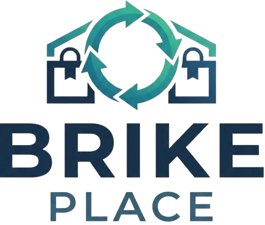

<div align="center">



# Brike Place

**Marketplace de compra e venda de usados — economia e desapego consciente.**


</div>

---

## Sobre o projeto

O **Brike Place** é um protótipo de marketplace para quem quer **desapegar** de itens novos ou usados e para quem procura boas oportunidades de forma simples, rápida e direta. A negociação acontece diretamente entre anunciante e comprador, via WhatsApp ou telefone.

O projeto é totalmente **front-end** (HTML, CSS e JavaScript puro), sem back-end e sem dependências: basta abrir no navegador.

## Funcionalidades

- **Vitrine de desapegos** com cards de produto (foto, título, preço e estado de conservação).
- **Cadastro de anúncio** com formulário completo:
  - título, categoria, estado de conservação, valor e opção de "valor negociável";
  - descrição detalhada e upload de fotos (**máximo de 5**, validado no navegador);
  - nome do anunciante, WhatsApp/telefone (**com máscara automática** `(00) 90000-0000`), cidade e bairro.
- **Armazenamento local:** o anúncio publicado é salvo no `localStorage` do navegador (chave `brike_anuncios`), com as fotos convertidas para Base64.
- **Página "Como Funciona"** com o passo a passo e dicas de negociação segura.
- **Página "Meus Anúncios"** para listar os itens do anunciante.
- **Layout responsivo**, com design system próprio em variáveis CSS.

## Páginas

| Arquivo | Descrição |
| --- | --- |
| `startup.html` | Página inicial com a vitrine "Desapegos Recentes" |
| `pgDesp.html` | Formulário "Anunciar Desapego" |
| `anuncios.html` | "Meus Anúncios" |
| `comofunc.html` | "Como Funciona" |

## Tecnologias

- **HTML5** semântico
- **CSS3** (Grid, Flexbox, variáveis CSS, media queries)
- **JavaScript** (DOM, `FileReader`, `localStorage`)
- Fonte [Inter](https://fonts.google.com/specimen/Inter) (Google Fonts)

## Como executar

Não é necessário instalar nada.

**Opção 1 — direto no navegador**

1. Clone o repositório:
   ```bash
   git clone <URL-DO-REPOSITORIO>
   ```
2. Abra o arquivo `startup.html` no navegador (duplo clique).

**Opção 2 — com servidor local (VS Code + Live Server)**

1. Abra a pasta do projeto no VS Code.
2. Clique com o botão direito em `startup.html` e escolha **Open with Live Server**.

> O repositório inclui `Site01/.vscode/launch.json`, uma configuração do VS Code para abrir o Chrome em `http://localhost:8080`.

## Estrutura de arquivos

```
.
├── startup.html        # Página inicial (vitrine)
├── pgDesp.html         # Cadastro de desapego
├── anuncios.html       # Meus anúncios
├── comofunc.html       # Como funciona
├── startup.css         # Estilos globais (design system)
├── cadastro.js         # Lógica do formulário, busca e localStorage
├── LOGOAJUSTADA-removebg-preview.png   # Logo
├── *.jpg / *.png / *.jfif              # Imagens dos produtos de exemplo
└── Site01/.vscode/launch.json          # Configuração de debug (VS Code)
```

## Identidade visual

| Cor | Hex | Uso |
| --- | --- | --- |
| Azul da marca | `#1e3a5f` | Rodapé e identidade |
| Verde | `#10b981` | Botões, preços e destaques |
| Fundo | `#f8fafc` | Fundo do site |
| Texto principal | `#1e293b` | Textos |

## Status do projeto e próximos passos

O Brike Place está em fase de **protótipo**. Pontos conhecidos a evoluir:

- [ ] Exibir nas páginas **Início** e **Meus Anúncios** os anúncios salvos no `localStorage` (hoje elas mostram cards de exemplo fixos).
- [ ] Fazer a **busca** funcionar: o termo é enviado na URL (`startup.html?busca=...`), mas a vitrine ainda não filtra os produtos.
- [ ] Corrigir o botão **Cancelar** do formulário, que aponta para `index.html` (a página inicial é `startup.html`).
- [ ] Corrigir o link da fonte Inter (Google Fonts) nos `<head>` das páginas.
- [ ] Padronizar os nomes das imagens (`tenis`, `relogio` e `camera` estão sem extensão).
- [ ] Back-end e banco de dados para persistir anúncios e fotos fora do navegador.
- [ ] Contato direto com o anunciante (link para WhatsApp) e filtros por categoria.

## Autor

Desenvolvido por **Erik**.
